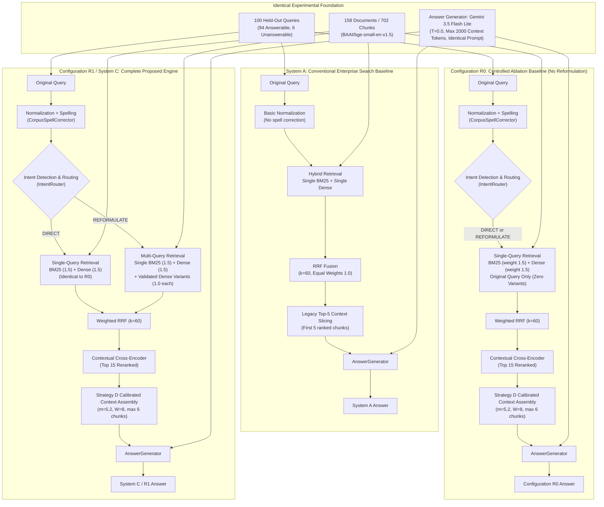

# Phase 3: Evaluation Methodology & Experimental Design

**Project:** Query Reformulation Engine for Enterprise Search  
**Document:** End-to-End Evaluation Protocol, Metric Definitions & Controlled Experimental Design  
**Status:** Approved & Calibrated for Final Execution  
**Date:** November 2026  
**Target Evaluation Corpus:** 158 Documents, 702 Chunks (`Data/chunks/chunks.jsonl`)  
**Target Benchmark:** 100 Held-out Queries (`evaluation/heldout_queries.json`)

---

## 1. Research Questions & Hypotheses

Phase 3 is structured around two distinct, decoupled empirical questions:

### Question 1: System-Level Enterprise Search Effectiveness (System A vs System C)
> **Does the complete proposed Query Reformulation Engine (System C) produce better enterprise search results and more useful, complete, and factually grounded final answers than conventional enterprise search (System A)?**

- **Scope:** Evaluates the aggregate impact of the entire proposed technology stack—including corpus-based spell correction, intent routing, LLM reformulation, semantic filtering, multi-query dense retrieval, contextual cross-encoder reranking, and calibrated relative-margin context assembly—against standard enterprise search.
- **Critical Methodological Boundary:** Comparison A vs C evaluates the **complete system-level improvement**. It **does not** isolate the contribution of query reformulation, and improvements in System C must **never** be attributed to query reformulation alone.

### Question 2: Isolated Contribution of Query Reformulation (Configuration R0 vs Configuration R1)
> **Does adding validated query reformulation variants to dense retrieval measurably improve retrieval recall, ranking quality, and downstream answer quality when all other pipeline stages are held strictly constant?**

- **Scope:** Directly isolates the marginal contribution of query reformulation. Both configurations share identical normalization, spell correction, intent detection, direct-search routing, BM25 retrieval, primary-query dense retrieval, RRF parameters, contextual cross-encoder reranking, Strategy D context assembly, and answer-generation settings.

### Hypotheses

- **$H_{0,\text{system}}$ (Null System Hypothesis):** System C produces answer quality and retrieval effectiveness that are statistically indistinguishable from, or inferior to, System A ($p \ge 0.05$).
- **$H_{1,\text{system}}$ (Alternative System Hypothesis):** System C achieves statistically significant improvements in answer correctness, completeness, and multi-document reasoning over System A ($p < 0.05$).
- **$H_{0,\text{ablation}}$ (Null Reformulation Hypothesis):** Adding reformulation variants to dense retrieval in Configuration R1 provides no statistically significant benefit over Configuration R0 ($p \ge 0.05$).
- **$H_{1,\text{ablation}}$ (Alternative Reformulation Hypothesis):** Multi-query dense reformulation in Configuration R1 yields statistically significant gains in candidate coverage and downstream answer completeness compared to Configuration R0 ($p < 0.05$).

---

## 2. Experimental Configurations & Architectural Controls

To ensure unambiguous causality, three experimental configurations are evaluated under strict experimental controls:



### 2.1. Architectural Variable Matrix

| Pipeline Component | System A (Conventional Baseline) | Configuration R0 (Controlled Ablation Baseline) | Configuration R1 / System C (Proposed Engine) | Control Status |
|---|---|---|---|---|
| **Query Normalization** | Basic string normalization (strip whitespace/punct) | Normalization + `CorpusSpellCorrector` | Normalization + `CorpusSpellCorrector` | **Identical between R0 and R1** |
| **Intent Detection** | None (uniform execution) | `IntentRouter` enabled | `IntentRouter` enabled | **Identical between R0 and R1** |
| **Direct-Search Routing** | None | `DIRECT` routes to single-query retrieval | `DIRECT` routes to single-query retrieval | **Identical between R0 and R1** |
| **Reformulation Variants** | None | **DISABLED** (Zero variants across all queries) | **ENABLED** (Up to 5 variants for `REFORMULATE` only) | **ISOLATED VARIABLE (R0 vs R1)** |
| **Semantic Filtering** | None | N/A (no variants generated) | BGE cosine bounds $[0.40, 0.90]$ | Associated with reformulation |
| **BM25 Retrieval** | Okapi BM25 on normalized query (weight 1.0) | Okapi BM25 on normalized query (weight 1.5) | Okapi BM25 on normalized query (weight 1.5) | **Identical between R0 and R1** |
| **Dense Vector Retrieval** | BGE-small on normalized query (weight 1.0) | BGE-small on normalized query (weight 1.5) | BGE-small on normalized query (weight 1.5) + variants (weight 1.0) | **ISOLATED VARIABLE (R0 vs R1)** |
| **RRF Fusion** | $k=60$, equal branch weights ($1.0 / 1.0$) | $k=60$, primary query weight 1.5 | $k=60$, primary query weight 1.5 | **Identical between R0 and R1** |
| **Candidate Pool Depth** | $K=20$ | $K=50$ | $K=50$ | **Identical between R0 and R1** |
| **Cross-Encoder Reranking** | None (pure RRF order) | `ms-marco-MiniLM-L-6-v2` reranks Top 15 | `ms-marco-MiniLM-L-6-v2` reranks Top 15 | **Identical between R0 and R1** |
| **Context Assembly** | Legacy Top 5 chunks (`strategy="legacy"`) | Strategy D Calibrated Relative-Margin ($m=5.2$, $W=8$) | Strategy D Calibrated Relative-Margin ($m=5.2$, $W=8$) | **Identical between R0 and R1** |
| **Context Token Limit** | 2000 tokens | 2000 tokens | 2000 tokens | **Identical across all three** |
| **Answer Generator** | `gemini-3.5-flash-lite`, $T=0.0$ | `gemini-3.5-flash-lite`, $T=0.0$ | `gemini-3.5-flash-lite`, $T=0.0$ | **Identical across all three** |
| **Prompt Template** | `_PROMPT_TEMPLATE` JSON contract | `_PROMPT_TEMPLATE` JSON contract | `_PROMPT_TEMPLATE` JSON contract | **Identical across all three** |
| **Citation Validation** | Validated against provided context chunks | Validated against provided context chunks | Validated against provided context chunks | **Identical across all three** |

### 2.2. Mathematical Isolation of Variables

1. **Comparison A vs C (System-Level Effect):**
   $$\Delta_{\text{System}} = \text{Score}(\text{System C}) - \text{Score}(\text{System A})$$
   Measures the combined impact of all algorithmic advancements over conventional search.

2. **Comparison R0 vs R1 (Isolated Reformulation Effect):**
   $$\Delta_{\text{Reformulation}} = \text{Score}(\text{Configuration R1}) - \text{Score}(\text{Configuration R0})$$
   Because all upstream components (normalization, spell-correction, intent routing) and all downstream components (BM25, primary-query dense retrieval, RRF, cross-encoder, Strategy D context assembly, prompt, LLM generator) are identical, $\Delta_{\text{Reformulation}}$ isolates the exact contribution of multi-query dense reformulation.

3. **Comparison A vs R0 (Downstream Stack Contribution):**
   $$\Delta_{\text{Downstream}} = \text{Score}(\text{Configuration R0}) - \text{Score}(\text{System A})$$
   Measures the impact of spell-checking, contextual cross-encoder reranking, and Strategy D context assembly in the absence of query reformulation.

---

## 3. Reference Dataset Architecture (`phase3_reference_answers.json`)

To evaluate answer quality objectively without fabricating facts, ground-truth reference data is compiled for all 100 held-out queries.

### 3.1. Construction Protocol
- **Source of Truth:** Verified text chunks in `Data/chunks/chunks.jsonl` matching `relevant_chunks` and factual `description` entries in `evaluation/heldout_queries.json`.
- **Zero Hallucination Principle:** Every expected fact, condition, exception, and deadline must be directly traceable to specific chunk text.
- **Evidence Mapping:** For every essential fact, its supporting chunk IDs must be documented explicitly.
- **Unanswerable Ground Truth:** The 6 unanswerable queries (H004, H048, H055, H058, H080, H089) have explicit reasons documenting why the corpus cannot answer the query and what a correct abstention must state.

### 3.2. Reference Schema Specification
```json
{
  "query_id": "H001",
  "original_query": "bus pass refund",
  "category": "keyword",
  "answerable": true,
  "single_document_or_multi_document": "single_document",
  "required_document_ids": ["TRANS-SOP-001"],
  "supporting_chunk_ids": ["TRANS-SOP-001_CHUNK_004"],
  "expected_answer_or_abstention": "Bus pass cancellation refund tiers: 90% before classes, 50% within first 15 days, zero after 15 days (except medical/withdrawal); credited to bank in 14 working days.",
  "essential_facts": [
    {
      "fact": "Bus pass cancellation refund tiers: 90% before classes, 50% within first 15 days, zero after 15 days (except medical/withdrawal)",
      "supporting_chunk_ids": ["TRANS-SOP-001_CHUNK_004"]
    },
    {
      "fact": "Credited to bank in 14 working days",
      "supporting_chunk_ids": ["TRANS-SOP-001_CHUNK_004"]
    }
  ],
  "abstention_expected": false,
  "abstention_rationale": null,
  "annotation_rationale": "Directly grounded in TRANS-SOP-001_CHUNK_004 (Section: 4. PASS CANCELLATION AND FEE REFUND NORMS)."
}
```

---

## 4. Evaluation Dimensions & Scoring Rubrics

Each generated answer will be assessed across six core dimensions.

### 4.1. Factual Correctness (Scale 0 to 4)
- **4 (Fully Correct):** Every stated fact, number, deadline, and policy condition is 100% accurate and fully verified by the source documents. Zero errors.
- **3 (Mostly Correct):** Main conclusion is accurate; minor non-critical detail omitted or slightly imprecise, but no misleading or conflicting statements.
- **2 (Partially Correct):** Contains a mixture of correct and incorrect facts, or misattributes a rule/condition.
- **1 (Mostly Incorrect):** Fails on primary facts; conveys an erroneous policy interpretation with minor incidental correct keywords.
- **0 (Incorrect / Fabricated):** Entirely wrong, hallucinates non-existent policies, or asserts falsehoods.

### 4.2. Completeness (Scale 0 to 4)
- **4 (Fully Complete):** Covers 100% of essential facts, required conditions, exceptions, and procedural steps.
- **3 (Mostly Complete):** Covers $\ge 75\%$ of essential facts; omits only secondary procedural details.
- **2 (Partially Complete):** Covers $50\% - 74\%$ of essential facts; leaves out major requirements or conditions.
- **1 (Minimally Complete):** Covers $< 50\%$ of essential facts; provides only a vague fragment.
- **0 (Incomplete):** Does not answer the query, or states refusal when evidence was available.

### 4.3. Citation Correctness (Scale 0 to 4)
- **4 (Fully Correct):** Every cited chunk directly supports the accompanying claim, and all major claims are cited. No extraneous or misleading citations.
- **3 (Mostly Correct):** Major claims are properly cited; includes one tangentially related or slightly noisy citation.
- **2 (Partially Correct):** Some citations support claims, but several claims lack citations or cite irrelevant chunks.
- **1 (Mostly Incorrect):** Most cited chunks do not contain the asserted facts.
- **0 (Absent / Invalid):** No citations provided, citations fabricated, or completely mismatched.

### 4.4. Groundedness (Claim-Level Ratio)
$$\text{Groundedness Ratio} = \frac{\text{Supported Factual Claims}}{\text{Total Factual Claims}}$$
- Measures proportion of claims strictly substantiated by the context provided to the LLM.
- Tracks unsupported claim rate and contradictory claim rate.

### 4.5. Multi-Document Reasoning (41 Multi-Doc Queries)
- **Document Coverage:** Did the answer incorporate all required target documents?
- **Relationship Preservation:** Were conditions from Document A correctly linked to consequences in Document B?
- **Secondary Document Omission Rate:** Proportion of queries where critical evidence available only in secondary documents was omitted.

### 4.6. Abstention Quality (6 Unanswerable Queries)
- **Correct Abstention:** The system explicitly returns `answerable: false` and clearly communicates that the requested information is absent from the available documents.
- **Hallucinated Answer (Severe Penalty):** The system invents an answer or assumes external knowledge when documents do not contain the answer.
- **Metric Output:** Correct Abstention Rate ($\frac{\text{Correct Refusals}}{\text{Total Unanswerable Queries}}$).

---

## 5. Statistical Analysis & Paired Comparison Framework

All evaluations are paired on identical queries:
- **Metrics Evaluated:**
  - Mean and median differences.
  - Count of Improved, Degraded, and Unchanged queries.
  - 95% Confidence Intervals using paired bootstrap resampling (10,000 iterations).
  - Wilcoxon signed-rank test (non-parametric).
  - Paired Student's t-test where distribution assumptions hold.
- **Small-Sample Isolation:** The 6 unanswerable queries are analyzed and reported separately from the 94 answerable queries to prevent skewing distribution metrics.

---

## 6. Execution Protocol & Deliverables

All deliverables will be preserved in `evaluation/phase3/`:

1. `phase3_architecture_audit.md` (Approved)
2. `phase3_evaluation_methodology.md` (This document)
3. `phase3_reference_answers.json` (Validated ground truth references for all 100 queries)
4. `phase3_reference_validation_report.md` (Validation audit of reference answers)
5. `validate_reference_answers.py` (Deterministic reference verification script)
6. `phase3_system_a_answers.json` (Trace of System A execution)
7. `phase3_reformulation_ablation_answers.json` (Trace of Configuration R0 and R1 execution)
8. `phase3_system_c_answers.json` (Trace of System C execution)
9. `phase3_answer_metrics.json` (Comparative answer-quality metrics and statistical tests)
10. `phase3_retrieval_metrics.json` (Comparative retrieval, coverage, and context metrics)
11. `phase3_per_query_comparison.json` (Detailed query-by-query breakdown and deltas)
12. `phase3_human_audit_report.md` (30-query representative manual review)
13. `phase3_failure_analysis.md` (Deep dive into regressions, ties, and failure modes)
14. `phase3_final_report.md` (Comprehensive research paper answering all core questions)
